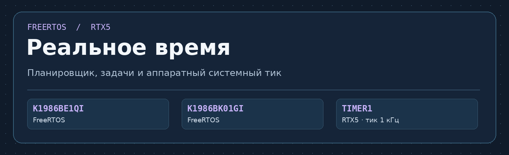

# FreeRTOS и RTX5 на МК Миландр

Три примера для Keil µVision, которые показывают запуск планировщика на **К1986ВЕ1QI** и **К1986ВК01GI**, а также подключение аппаратного таймера в качестве источника системного тика RTX5.

| Проект | ОСРВ и платформа | Что демонстрирует |
| --- | --- | --- |
| [freertos-k1986ve1qi](freertos-k1986ve1qi/) | FreeRTOS 10.5.1 · К1986ВЕ1QI | Запуск планировщика и периодическую задачу управления светодиодами |
| [freertos-k1986vk01gi](freertos-k1986vk01gi/) | FreeRTOS 10.5.1 · К1986ВК01GI | Три задачи для RGB-светодиода и варианты загрузки в Flash и RAM |
| [rtx5-k1986ve1qi](rtx5-k1986ve1qi/) | RTX5 · К1986ВЕ1QI | OS Tick API на TIMER1 с частотой тика 1 кГц |

## FreeRTOS

Для обоих проектов нужен **Arm Compiler 5.06**. Исходные конфигурации используют следующие пакеты устройств.

- **К1986ВЕ1QI** — `Milandr.MDR32FxQI.1.0`. Откройте [FreeRTOS_1QI.uvprojx](freertos-k1986ve1qi/FreeRTOS_1QI.uvprojx), затем проверьте Startup, PORT и RST_CLK в **Manage Run-Time Environment**.
- **К1986ВК01GI** — `Keil.MDR1986VK01.1.3` и CMSIS Core 5.5.0. Откройте [FreeRTOS_VK01.uvprojx](freertos-k1986vk01gi/FreeRTOS_VK01.uvprojx), восстановите компоненты Startup, DEMOBOARD, Leds, CLK, PORT и TIMER. Выберите **FLASH** или **RAM** для вашего стенда.

Чтобы совпасть с исходными настройками статьи, скопируйте `RTE/Device/` из архива нужной платы в каталог её проекта. Для К1986ВК01GI также скопируйте `RTE/Board_Support/`. Архивы доступны в конце статьи. [Портирование FreeRTOS и проекты][freertos].

## RTX5 и аппаратный тик

Откройте [HelloWorld.uvprojx](rtx5-k1986ve1qi/HelloWorld.uvprojx) с **Arm Compiler 5.06** и пакетом `Milandr.MDR32FxQI.1.0`. В **Manage Run-Time Environment** восстановите Startup, PORT, RST_CLK и TIMER. Для этого проекта нужно добавить следующие файлы поддержки.

| Что взять | Куда поместить |
| --- | --- |
| `RTX_CM0.lib` из архива `RTOS2_OSTICKAPI_K1986BE1QI.zip` | `rtx5-k1986ve1qi/RTX_CM0.lib` |
| Каталог `CMSIS/` из пакета `ARM.CMSIS.5.4.0` | `rtx5-k1986ve1qi/cmsis-5.4.0/CMSIS/` |

В созданном Keil файле запуска направьте вектор **TIMER1** на `SysTick_Handler`, как показано в статье. Затем соберите пример и проверьте периодическое переключение светодиода. В [api_os_tick.c](rtx5-k1986ve1qi/api_os_tick.c) исправлен инкремент предделителя при расчёте ARR. Функции мониторинга тика в исходном демонстрационном примере оставлены заглушками. [Подробности процедуры и архив RTX5][rtx].

Автор статей — **Илья Лампадов**. Проекты сохраняют уведомления авторов из исходных архивов. Ядро FreeRTOS имеет лицензию [MIT](LICENSES/FreeRTOS-MIT.txt), а файлы конфигурации RTX с уведомлением Arm — [Apache-2.0](LICENSES/Apache-2.0.txt). [FreeRTOS][freertos] · [RTX5][rtx].

[freertos]: https://support.milandr.ru/base/primenenie/programmirovanie-32-razryadnykh-mk/osobennosti-primeneniya-know-how/49937/
[rtx]: https://support.milandr.ru/base/primenenie/programmirovanie-32-razryadnykh-mk/osobennosti-primeneniya-know-how/24210/
